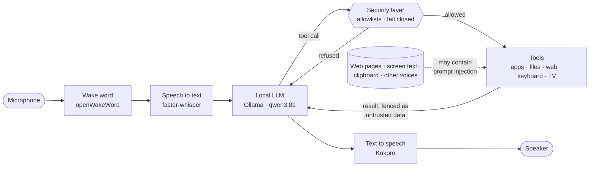

# Bastion

**A fully local AI voice assistant that can actually control your PC, built so a
tricked model still can't hurt you.**

Built with AI tools. I planned it, directed the build, and tested it.

Bastion listens for its wake word, answers out loud, and can open apps, read
your files, type, search the web, read your screen and turn on your TV. Every
model runs on your own machine. By default, nothing you say, no file it reads
and no screenshot it takes leaves the computer. (Two optional extras, a cloud
model backend and crash alerts to Discord, are off unless you turn them on in
`config.py`; the alerts carry failure details only, never content.)

The interesting part isn't the assistant. It's the question every tool-using AI
has to answer: **once a language model can act, what stops a malicious web page
from telling it to act for someone else?** Bastion's answer is a security layer
that sits between the model and the machine, which the model cannot argue with.

> Read the full threat model and defences in **[SECURITY.md](SECURITY.md)**.

---

## How it works



The model is treated as an **untrusted caller**. Its context fills up with text
the owner never wrote (web pages, screen text, clipboard, other people
talking), and any of it can contain instructions. So every tool argument goes
through code the model can't influence:

| The model asks to... | Bastion checks |
| --- | --- |
| read a file | the resolved path is inside an allowed folder (no `..`, no lookalike folders, no network shares) |
| fetch a web page | the scheme is http/https and the host doesn't resolve to your router, `localhost` or cloud metadata, on every redirect |
| type text | no control characters, and the focused window is an allowed app, never a terminal or a dialog |
| open an app | the name is on an allowlist and launches without a shell |
| read the clipboard or open an unknown site | a real person clicks yes on a Windows dialog |

Everything a tool returns goes back to the model wrapped as untrusted data, so
instructions hidden in a web page arrive labelled as text to report on, not
orders to follow.

## What it can do

- **Talk:** wake word, streaming speech recognition, natural British voice,
  interruptible replies
- **Your PC:** open and close apps, type, press shortcuts, volume, media keys,
  clipboard, system status
- **Your files:** list and read documents in allowed folders
- **The web:** search, fetch and summarise pages, Wikipedia, news, weather,
  directions, currency, definitions
- **Your screen:** read text off the screen and describe what's on it (only when
  asked, never continuously)
- **Your TV:** power, inputs and apps on Roku TVs over the local network
- **Memory:** remembers facts you tell it, in a local SQLite database

28 tools in all, every one routed through a single `dispatch()`.

## Security tests

```
pytest tests/
```

`tests/test_security.py` is a set of attacks a prompt-injected model could try.
Each must be refused: path traversal, prefix confusion, SSRF to private and
metadata addresses, DNS names that resolve inside the network, `file:` and
`javascript:` URLs, keystroke injection through newlines and escape codes,
shell fragments in app names, typing into consoles and dialogs, and dodging the
blocklist with uppercase names. They run offline in CI on every push.

## Stack

| Part | Choice | Why |
| --- | --- | --- |
| LLM | Ollama, `qwen3:8b` | Runs on an 8 GB GPU, solid tool calling, thinking mode for harder questions |
| Speech to text | faster-whisper `small.en`, CPU int8 | Keeps the GPU free for the LLM |
| Text to speech | Kokoro (Piper fallback) | Natural voice, fast enough to stream sentence by sentence |
| Wake word | openWakeWord | Always listening, entirely on device |
| Vision | moondream | Only when asked to look at the screen |
| Storage | SQLite | Local memory, parameterised queries throughout |

## Running it

Windows 10/11, Python 3.12, and [Ollama](https://ollama.com) with `qwen3:8b`
pulled.

```
python -m venv .venv
.venv\Scripts\activate
pip install -r requirements.txt
python bastion.py
```

Say **"Hey Jarvis"** to wake it. That phrase is openWakeWord's pretrained model;
train your own to change it.

All settings, and the entire security policy, live in one file:
[`config.py`](config.py). Widening an allowlist is a security decision, so it's
deliberately one place to audit.

## Project layout

| File | Role |
| --- | --- |
| `bastion.py` | Chat loop: streaming, tool-call rounds, history limits |
| `tools.py` | Every tool and the single `dispatch()` they go through |
| `security.py` | Path, URL, text, app and window checks |
| `config.py` | Every setting and the whole security policy |
| `voice.py` | Wake word, microphone, speech to text, text to speech |
| `hud_server.py` | Authenticated local WebSocket feeding the on-screen display |
| `alerts.py` | Optional crash alerts (failure metadata only, never content) |
